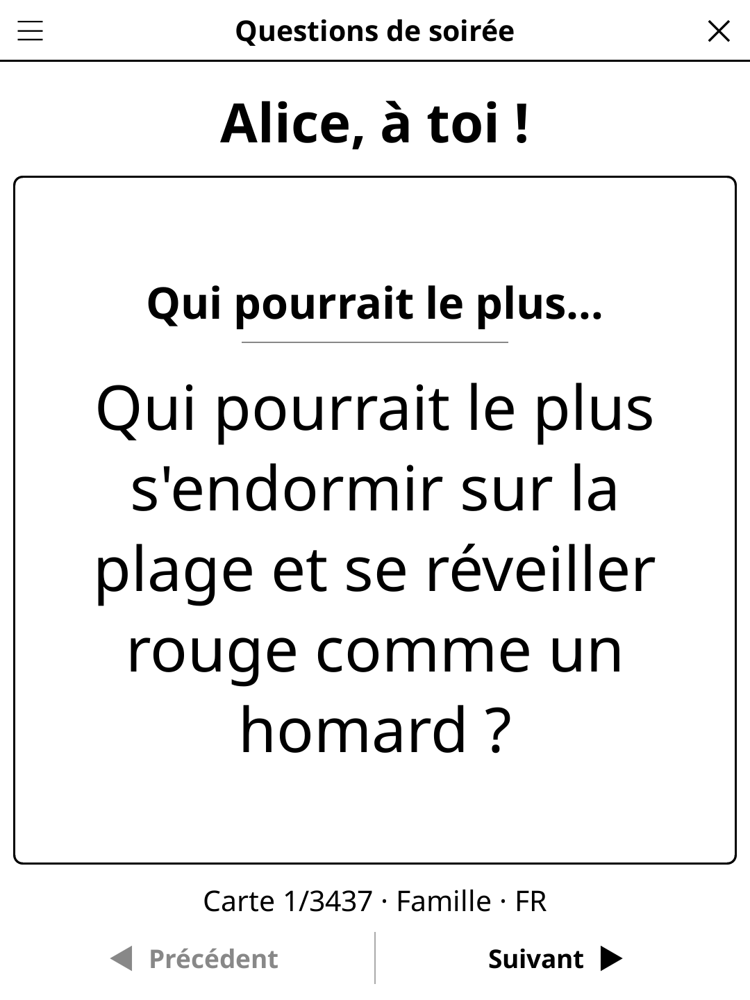

# partyquestions.koplugin

**Party Questions** (*Questions de soirée*) for [KOReader](https://github.com/koreader/koreader) — card decks to read aloud at a party, the reader passed from hand to hand.

## Screenshot



## Decks

| Deck | French | Example |
|------|--------|---------|
| Would you rather… | Tu préfères… | "Tu préfères dîner avec Napoléon ou faire un pique-nique avec Cléopâtre ?" |
| Never have I ever… | Je n'ai jamais… | Those who have done it own up. |
| Who's most likely to… | Qui pourrait le plus… | On three, everybody points at someone. |
| Get to know you | Pour mieux se connaître | Deep and fun questions. |
| Hot seat | Sur la sellette | One player answers three questions in a row. |
| Famous dinner | Dîner de légende | "Tu dînes avec Napoléon et Cléopâtre : de quoi parlez-vous ?" |
| Dilemmas | Dilemmes | Moral or absurd choices to argue about. |
| Absurd debates | Débats absurdes | "Napoléon contre un T-Rex : qui gagne ?" |
| This or that | Ceci ou cela | Rapid-fire: "Raclette ou fondue ?" |
| Story starters | Il était une fois | Read the opening, each player adds a sentence. |
| Guess who | Qui est-ce ? | Describe the famous person in three words, the others guess. |
| Time machine | Machine à remonter le temps | Which era, which person, what would you do? |

The six classic decks have 316–360 family cards per language, the six new ones 217–307. The opt-in **Adults** mode (confirmation asked) adds 409 spicier cards per language — dating, exes, embarrassing nights — never explicit, never hateful. In all: 3437 French and 3303 English family cards. Decks are loaded on first use; all twelve decks of one language take about 440 KB once loaded.

## Play

- **Next / Previous** — cards come in a random order with no repeats until the deck is exhausted; "Previous" goes back through the cards already seen.
- Add player names (optional) to see whose turn it is: "Alice, à toi !", "Bob sur la sellette !".
- When the deck is exhausted, "New game" reshuffles it.
- The current game (order, position) is saved when the screen is closed.

## Settings (title-bar menu)

New game · Language (content FR/EN) · Players · Decks (multi-select) · Mode (Family/Adults) · Rules

The interface follows KOReader's language; the cards follow the Language setting.

## Development

`deck.lua` is the pile/history logic (pure Lua, no UI), `screen.lua` the screen, `players.lua` the player-name editor, `cards/<lang>/<deck>.lua` the cards (`{ family = {...}, adult = {...} }`, loaded on first use). `test_deck_spec.lua` covers the deck logic and checks the content counts.

```
busted test_deck_spec.lua
```

## License

GPL-3.0
